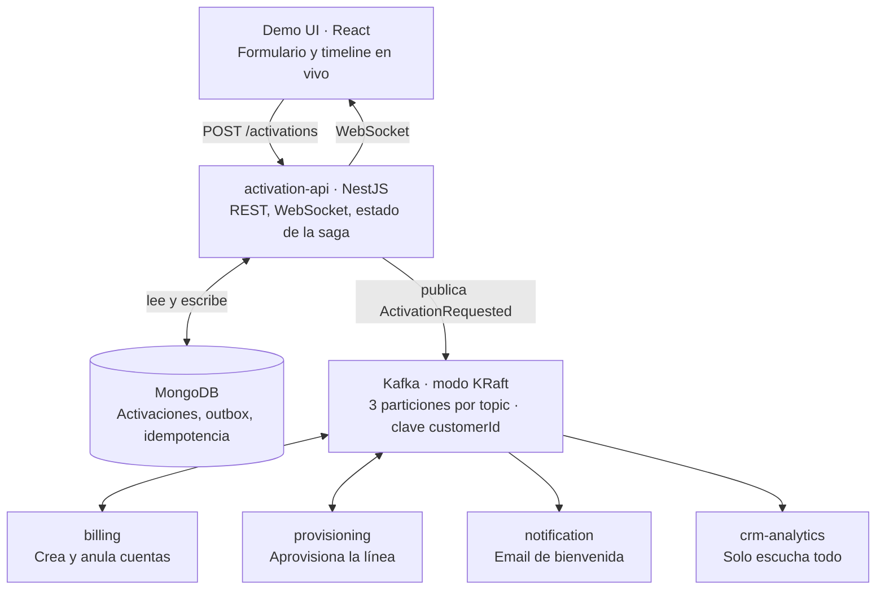
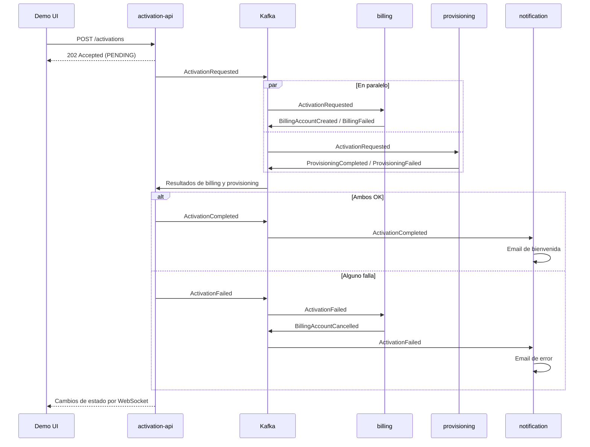
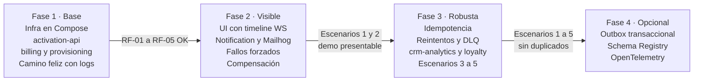

# POC Activación de Servicios con Kafka

**Ingeniería en Sistemas de Información**  
**Sistemas Distribuidos - 2026**

*Documento de arquitectura · Kafka, NestJS y React*

## 01. Resumen

La POC demuestra que la activación de un plan puede resolverse publicando un único evento en Kafka, sin que ningún servicio llame directamente a otro. Un cliente contrata un plan desde una UI en React; eso dispara facturación, aprovisionamiento, notificación y registro en CRM, coordinados por eventos.

## 02. Alcance

La POC corre completa en local con Docker Compose y simula los sistemas externos; no se integra con sistemas reales.

### Incluido

- UI de demo con formulario de contratación y timeline de eventos en vivo.
- Cinco servicios NestJS: `activation-api`, `billing`, `provisioning`, `notification` y `crm-analytics`.
- Kafka de un broker en modo KRaft, Kafka UI y MongoDB.
- Fallos forzados desde la UI, compensación, idempotencia, reintentos y DLQ (*Dead Letter Queue*, cola de mensajes muertos).
- Guion de demo con cinco escenarios.

### Fuera de alcance

- Integración con BSS, checkout o proveedores reales.
- Autenticación y autorización de usuarios.
- Alta disponibilidad: múltiples brokers, réplicas y despliegue en la nube.
- Pruebas de carga y métricas de rendimiento.
- Schema Registry y trazas distribuidas, que quedan como fase opcional.

## 03. Stack tecnológico

El stack prioriza levantar todo con un comando y hacer visible lo que pasa dentro de Kafka durante la demo.

| Componente | Tecnología | Por qué |
|---|---|---|
| Mensajería | Apache Kafka, modo KRaft, 1 broker | Sin ZooKeeper; un broker alcanza para demostrar particiones, offsets y consumer groups. |
| Servicios | NestJS + `@nestjs/microservices` (transporte Kafka) | `@EventPattern` y `ClientKafka` reducen el código de integración; estructura modular y tipada. |
| Frontend | React + Vite + `socket.io-client` | Arranque rápido; WebSocket para la timeline en vivo. |
| Persistencia | MongoDB | Documento flexible para el estado de la activación; soporta transacciones para el outbox. |
| Observabilidad | Kafka UI (kafbat) | Muestra topics, mensajes, particiones y lag de consumidores en vivo. |
| Email simulado | Mailhog | Bandeja de entrada visible para las notificaciones. |
| Entorno | Docker Compose | Un solo comando para levantar todo. |
| Monorepo | Modo monorepo de Nest o pnpm workspaces | Contratos de eventos compartidos en una librería. |

**Alternativa:** Redpanda con Redpanda Console es más liviano y compatible con la API de Kafka, pero la demo pierde el valor de mostrar Kafka tal como se usaría en producción.

## 04. Arquitectura

`activation-api` es el único punto de entrada; todo lo demás reacciona a eventos en Kafka.



*Arquitectura de la POC: 7 componentes, 4 topics.*

Billing y provisioning trabajan en paralelo sobre el mismo evento y publican su resultado; `activation-api` junta ambos y decide si la activación terminó bien o mal.

### Componentes

- **Demo UI (React + Vite).** Formulario “Contratar plan” con cliente, plan y un selector para forzar un fallo en billing o provisioning. Muestra la timeline de eventos de cada activación, recibida por WebSocket.
- **activation-api (NestJS).** Expone `POST /activations` y `GET /activations/:id`, guarda la activación y publica `ActivationRequested`. Consume los resultados de billing y provisioning, mantiene el estado de la saga y publica `ActivationCompleted` o `ActivationFailed`. Un `@WebSocketGateway` envía cada cambio a la UI.
- **billing-service.** Consume `ActivationRequested` y crea la cuenta de facturación simulada. Consume `ActivationFailed` para anular la cuenta (compensación).
- **provisioning-service.** Consume `ActivationRequested` y simula el aprovisionamiento con un retardo de 1 a 3 segundos. Puede fallar a pedido.
- **notification-service.** Consume `activation.events` y envía el email de bienvenida o de error a Mailhog.
- **crm-analytics-service.** Consume todos los topics y no publica nada. Demuestra que se puede sumar un consumidor sin tocar a los demás.
- **MongoDB.** Una base por servicio: el estado de cada activación, el outbox y los eventos ya procesados.
- **Kafka UI.** Herramienta de apoyo para mostrar topics, mensajes y consumer groups durante la demo.

## 05. Requerimientos

Los requerimientos se limitan a lo que la demo necesita mostrar; los no funcionales apuntan a confiabilidad del flujo, no a rendimiento.

### Funcionales

| ID | Requerimiento |
|---|---|
| RF-01 | La UI permite crear una activación indicando `customerId`, `planId` y un modo de fallo opcional (`ninguno`, `billing`, `provisioning`). |
| RF-02 | `POST /activations` responde `202 Accepted` con el `activationId` y el estado `PENDING`, sin esperar a los demás servicios. |
| RF-03 | `activation-api` publica `ActivationRequested` por cada activación creada. |
| RF-04 | Billing y provisioning procesan el mismo evento en paralelo y publican su resultado, éxito o fallo. |
| RF-05 | Con billing y provisioning OK, la activación pasa a `ACTIVE` y se publica `ActivationCompleted`. |
| RF-06 | Si alguno falla, la activación pasa a `FAILED`, se publica `ActivationFailed` y billing anula la cuenta si la había creado. |
| RF-07 | Notification envía un email por cada `ActivationCompleted` o `ActivationFailed`. |
| RF-08 | La UI muestra cada evento de la activación en una timeline, en tiempo real, vía WebSocket. |
| RF-09 | `GET /activations/:id` devuelve el estado actual y el historial de eventos. |
| RF-10 | `crm-analytics` registra todos los eventos y puede reprocesar el historial desde el inicio. |

### No funcionales

| ID | Requerimiento |
|---|---|
| RNF-01 | Todo el entorno se levanta con `docker compose up`. |
| RNF-02 | Los eventos de un mismo cliente se procesan en orden: clave de partición = `customerId`. |
| RNF-03 | Cada consumidor es idempotente: un evento repetido no produce efectos duplicados. |
| RNF-04 | Un mensaje que falla 3 veces va a la DLQ y no bloquea la partición. |
| RNF-05 | Si un servicio se cae y vuelve, procesa los eventos pendientes sin perder ninguno. |
| RNF-06 | Todos los eventos llevan `correlationId` para rastrear una activación de punta a punta. |
| RNF-07 | Los contratos de eventos viven en una librería compartida y tienen versión. |

## 06. Topics y contratos de eventos

Cuatro topics de negocio más sus DLQ; todos con 3 particiones, retención de 7 días y `customerId` como clave.

| Topic | Eventos | Productor | Consumidores (consumer group) |
|---|---|---|---|
| `activation.requested` | `ActivationRequested` | `activation-api` | `billing-svc`, `provisioning-svc`, `crm-analytics` |
| `billing.events` | `BillingAccountCreated`, `BillingFailed`, `BillingAccountCancelled` | `billing` | `activation-api`, `crm-analytics` |
| `provisioning.events` | `ProvisioningCompleted`, `ProvisioningFailed` | `provisioning` | `activation-api`, `crm-analytics` |
| `activation.events` | `ActivationCompleted`, `ActivationFailed` | `activation-api` | `notification-svc`, `billing-svc`, `crm-analytics` |
| `<topic>.dlq` | Mensajes que fallaron 3 veces | El consumidor que falló | Inspección manual en Kafka UI |

Todos los eventos comparten el mismo sobre. El payload cambia según el tipo de evento.

```json
{
  "eventId": "7c9e6679-7425-40de-944b-e07fc1f90ae7",
  "eventType": "ActivationRequested",
  "version": 1,
  "occurredAt": "2026-09-27T16:40:00Z",
  "correlationId": "act-0001",
  "customerId": "C-1234",
  "source": "activation-api",
  "payload": {
    "planId": "FLOW-FULL",
    "channel": "web",
    "simulateFailure": "none"
  }
}
```

| Campo | Uso |
|---|---|
| `eventId` | Identificador único; base de la idempotencia. |
| `eventType` + `version` | Permiten evolucionar el contrato sin romper consumidores. |
| `correlationId` | El `activationId`; agrupa todos los eventos de una activación en la timeline. |
| `customerId` | También es la clave del mensaje en Kafka; garantiza orden por cliente. |
| `source` | Servicio que publicó el evento. |
| `simulateFailure` | Solo para la demo: indica a billing o provisioning que deben fallar. |

**Convenciones:** nombres de eventos en pasado, porque describen un hecho; topics en `dominio.tipo`; los cambios compatibles suman campos opcionales y los incompatibles incrementan `version`.

## 07. Flujos

La activación termina bien solo si billing y provisioning confirman; cualquier fallo dispara la compensación en billing.



*Secuencia de la activación: camino feliz y compensación.*

### Estados de la activación

| Estado | Cuándo | Siguiente |
|---|---|---|
| `PENDING` | Al crear la activación | `IN_PROGRESS` |
| `IN_PROGRESS` | Llegó el primer resultado de billing o provisioning | `ACTIVE` o `FAILED` |
| `ACTIVE` | Billing y provisioning confirmaron | Final |
| `FAILED` | Alguno de los dos falló | Final, con compensación |

**Regla de agregación en `activation-api`:** guarda el resultado de cada servicio en el documento de la activación. Con los dos OK publica `ActivationCompleted`; con el primer fallo publica `ActivationFailed` e ignora resultados posteriores de esa activación, salvo registrarlos en el historial.

**Caso borde:** si provisioning falla antes de que billing cree la cuenta, billing puede recibir `ActivationFailed` antes de terminar. Billing debe anular la cuenta también si la crea después de haber visto el fallo.

## 08. Modelo de datos (MongoDB)

Cada servicio tiene su propia base; ninguno lee la base de otro. Dos colecciones, `outbox` y `processed_events`, son comunes a todos los servicios que publican o consumen.

| Colección | Servicio | Contenido | Índices |
|---|---|---|---|
| `activations` | `activation-api` | Estado de la activación, resultados parciales e historial de eventos | `_id = activationId`; `customerId` |
| `billing_accounts` | `billing` | Cuenta simulada por activación, con estado `CREATED` o `CANCELLED` | `activationId` único |
| `provisioning_orders` | `provisioning` | Orden simulada de aprovisionamiento | `activationId` único |
| `notifications` | `notification` | Emails enviados | `activationId + eventType` |
| `event_log` | `crm-analytics` | Copia de cada evento recibido | `eventId` único; `correlationId` |
| `outbox` | `activation-api`, `billing`, `provisioning` | Eventos pendientes de publicar | `status + createdAt` |
| `processed_events` | Todos los consumidores | `eventId` ya procesados | `eventId` único; TTL de 7 días |

Ejemplo de documento en `activations`:

```json
{
  "_id": "act-0001",
  "customerId": "C-1234",
  "planId": "FLOW-FULL",
  "status": "ACTIVE",
  "simulateFailure": "none",
  "steps": {
    "billing": {
      "status": "OK",
      "at": "2026-09-27T16:40:02Z"
    },
    "provisioning": {
      "status": "OK",
      "at": "2026-09-27T16:40:03Z"
    }
  },
  "history": [
    {
      "eventType": "ActivationRequested",
      "at": "2026-09-27T16:40:00Z"
    },
    {
      "eventType": "BillingAccountCreated",
      "at": "2026-09-27T16:40:02Z"
    },
    {
      "eventType": "ProvisioningCompleted",
      "at": "2026-09-27T16:40:03Z"
    },
    {
      "eventType": "ActivationCompleted",
      "at": "2026-09-27T16:40:03Z"
    }
  ],
  "createdAt": "2026-09-27T16:40:00Z",
  "updatedAt": "2026-09-27T16:40:03Z"
}
```

El TTL de `processed_events` coincide con la retención de los topics: un evento más viejo que eso ya no puede volver a llegar.

## 09. Decisiones técnicas

Cuatro decisiones hacen que el flujo sea confiable aunque los servicios se caigan o Kafka entregue un mensaje dos veces.

### 1. Idempotencia en cada consumidor

Kafka garantiza entrega “al menos una vez”: si un consumidor se cae después de procesar pero antes de confirmar el offset, recibe el mensaje de nuevo. Cada consumidor inserta el `eventId` en `processed_events`, con índice único, en la misma transacción que su efecto. Si la inserción falla por duplicado, descarta el evento y confirma el offset.

### 2. Reintentos y DLQ

Ante un error, el consumidor reintenta 3 veces con espera creciente: 1 s, 2 s y 4 s. Si sigue fallando, publica el mensaje original en `<topic>.dlq` con el motivo del error en los headers y continúa con el siguiente. Así, un mensaje roto no frena al resto de la partición.

Los errores de negocio simulados mediante `simulateFailure` no son errores técnicos: se publican como `BillingFailed` o `ProvisioningFailed`, no van a la DLQ.

### 3. Outbox transaccional (fase 4)

Sin outbox, si `activation-api` guarda en Mongo y se cae antes de publicar, el evento se pierde. Con outbox, la activación y el evento se guardan en la misma transacción de Mongo; un proceso aparte lee `outbox` cada 500 ms, publica los pendientes y los marca como enviados.

Para las fases 1 a 3 se publica directo después de guardar y se documenta el riesgo.

### 4. Cliente Kafka

Se usa el transporte Kafka de `@nestjs/microservices`, con `ClientKafka` para publicar y `@EventPattern` para consumir, que funciona sobre KafkaJS. Alcanza para la POC. Para un piloto conviene revisar el estado de mantenimiento de KafkaJS y evaluar el cliente oficial de Confluent para JavaScript.

### Otras decisiones

- **Coreografía con agregador.** Billing y provisioning reaccionan solos al evento; `activation-api` solo junta resultados. Es más simple que un orquestador que da órdenes y muestra mejor el desacople.
- Commit de offset manual, después de procesar, nunca antes.
- Mongo en replica set de un nodo, necesario para usar transacciones.

## 10. Estructura del repositorio y entorno local

Un monorepo con cinco apps NestJS, la UI y una librería de contratos; Docker Compose levanta la infraestructura y las apps.

```text
activation-poc/
├── apps/
│   ├── activation-api/          REST + WebSocket + agregador de la saga
│   ├── billing-service/
│   ├── provisioning-service/
│   ├── notification-service/
│   ├── crm-analytics-service/
│   └── demo-ui/                 React + Vite + socket.io-client
├── libs/
│   ├── contracts/               Tipos de eventos, sobre común, nombres de topics
│   └── kafka-toolkit/           Idempotencia, reintentos, DLQ, outbox
├── docker/
│   └── create-topics.sh         Crea los topics con 3 particiones
├── docker-compose.yml
└── docs/
    ├── architecture.md
    └── demo-script.md
```

`libs/contracts` es la única fuente de verdad de los eventos. `libs/kafka-toolkit` evita repetir en cada servicio la lógica de idempotencia, reintentos y DLQ.

### Servicios de Docker Compose

| Servicio | Imagen o build | Puerto local |
|---|---|---:|
| `kafka` | `apache/kafka` (KRaft, 1 nodo) | 9092 |
| `kafka-init` | `apache/kafka` + `create-topics.sh` | — |
| `kafka-ui` | `kafbat/kafka-ui` | 8080 |
| `mongo` | `mongo` (replica set de 1 nodo) | 27017 |
| `mailhog` | `mailhog/mailhog` | 8025 |
| `activation-api` | Build `apps/activation-api` | 3000 |
| `billing-service` | Build `apps/billing-service` | — |
| `provisioning-service` | Build `apps/provisioning-service` | — |
| `notification-service` | Build `apps/notification-service` | — |
| `crm-analytics-service` | Build `apps/crm-analytics-service` | — |
| `demo-ui` | Build `apps/demo-ui` | 5173 |

Variables de entorno comunes: `KAFKA_BROKERS`, `KAFKA_CLIENT_ID`, `KAFKA_GROUP_ID`, `MONGO_URI`. Las versiones exactas de las imágenes se fijan al armar el `docker-compose.yml`.

## 11. Guion de la demo

Cinco escenarios, cada uno demuestra un concepto de Kafka. Pantalla dividida: Demo UI a la izquierda, Kafka UI a la derecha.

| # | Escenario | Qué se hace | Qué se ve | Concepto |
|---:|---|---|---|---|
| 1 | Camino feliz | Contratar un plan sin fallo. | Timeline con 4 eventos en verde; email en Mailhog. | Fan-out: un evento, varias reacciones. |
| 2 | Fallo y compensación | Contratar con fallo en provisioning. | `ProvisioningFailed`, `ActivationFailed`, `BillingAccountCancelled`; email de error. | Saga sin llamadas directas. |
| 3 | Servicio caído | Detener notification, crear 3 activaciones y volver a levantarlo. | Kafka UI muestra lag de 3; al volver, llegan los 3 emails. | Offset: nadie pierde mensajes. |
| 4 | Escalar | Levantar una segunda instancia de billing. | Kafka UI reparte las 3 particiones entre 2 consumidores. | Consumer group y particiones. |
| 5 | Nuevo consumidor | Levantar un servicio loyalty con un group nuevo que lee desde el inicio. | Procesa todo el historial sin tocar a los demás. | Replay del log. |

### Comandos de apoyo

```bash
# Escenario 3
docker compose stop notification-service
docker compose start notification-service

# Escenario 4
docker compose up -d --scale billing-service=2

# Escenario 5 (loyalty con auto.offset.reset=earliest)
docker compose --profile loyalty up -d loyalty-service
```

El escenario 5 cierra la demo: muestra algo que con APIs directas no se puede hacer. Duración estimada: 15 minutos.

## 12. Plan de fases, criterios de aceptación y riesgos

Cuatro fases incrementales; la fase 4 solo se hace si la POC avanza a piloto. Cada rombo es el criterio para cerrar la fase.



*Plan por fases: 4 fases, 4 puntos de control.*

La fase 2 es la mínima para presentar; la fase 3 agrega los escenarios que muestran la resiliencia de Kafka.

### Criterios de aceptación de la POC

- [ ] `docker compose up` levanta todo sin pasos manuales.
- [ ] Los 5 escenarios del guion se ejecutan de punta a punta en menos de 15 minutos.
- [ ] Reenviar un evento ya procesado no genera cuentas ni emails duplicados.
- [ ] Un mensaje inválido termina en la DLQ y el resto del flujo sigue.
- [ ] Todos los eventos de una activación se pueden rastrear por **`correlationId`**.

### Riesgos

| Riesgo | Impacto | Mitigación |
|---|---|---|
| Kafka tarda en arrancar y los servicios fallan al conectar. | La demo no arranca. | `healthcheck` en Compose y `depends_on` con `condition: service_healthy`. |
| Rebalanceo lento al escalar billing, escenario 4. | Pausa visible de varios segundos. | Explicarlo como parte de la demo; ajustar `session.timeout.ms`. |
| Las transacciones de Mongo requieren replica set. | El outbox y la idempotencia no funcionan. | Mongo en replica set de un nodo desde la fase 1. |
| Mantenimiento limitado de KafkaJS. | Deuda técnica si la POC pasa a piloto. | Aislar el cliente en `libs/kafka-toolkit` para poder reemplazarlo. |
| La demo depende de la red local. | Fallo en vivo. | Grabar un video de respaldo de los 5 escenarios. |
