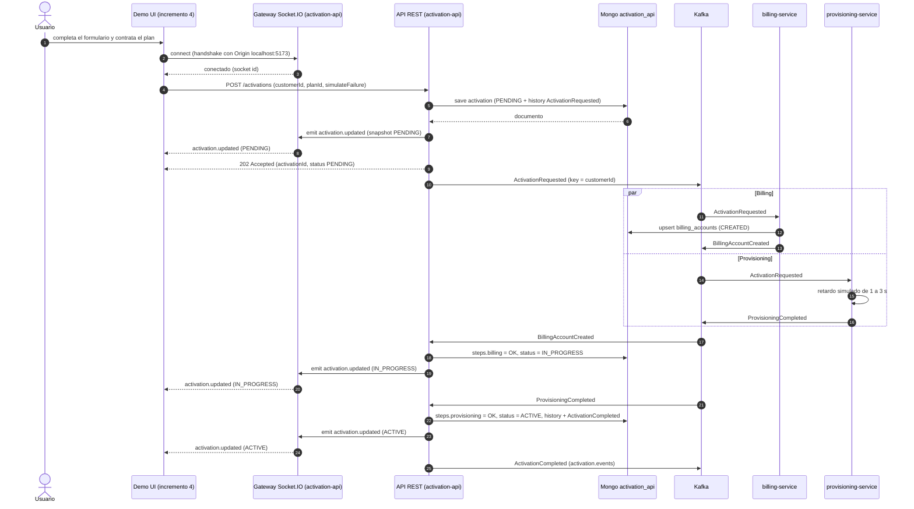
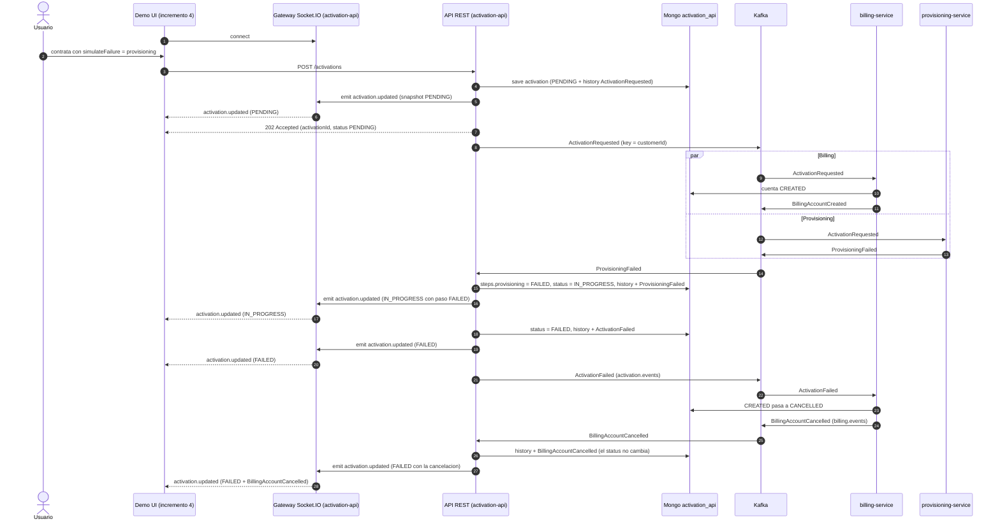
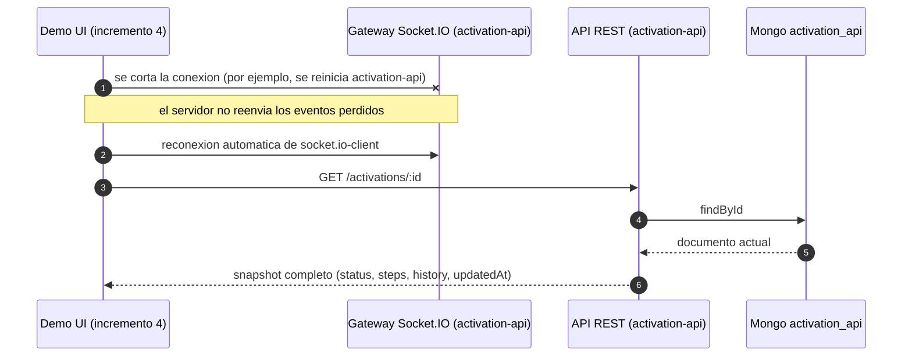

# Incremento 3 — WebSocket sobre `activation-api`

Diagramas de secuencia del incremento 3 de la Fase 2 (`docs/plan-fase-2.md`).

**Qué aporta este incremento**

- `activation-api` incorpora un gateway de Socket.IO que emite el evento `activation.updated` con el snapshot completo de la activación.
- Las emisiones ocurren después de cada cambio persistido: creación, resultado de cada paso, completitud, fallo y los eventos que solo agregan historial (por ejemplo `BillingAccountCancelled`).
- `GET /activations/:id` devuelve exactamente la misma forma que el evento de WebSocket, así que la UI trabaja con un único contrato.
- CORS habilitado por separado para HTTP y para el handshake de Socket.IO, con la misma lista de orígenes (`http://localhost:5173`, `http://127.0.0.1:5173`).

**Qué no cambia**

- No hay topics nuevos ni eventos nuevos: el flujo de Kafka es el de la Fase 1 más la compensación del incremento 2.
- No se modifica el modelo de datos de Mongo ni los contratos compartidos (`libs/contracts`).
- `billing-service`, `provisioning-service` y `notification-service` no se tocan.
- El WebSocket no reemplaza a REST: es un canal de notificación. Mongo sigue siendo la fuente de verdad.

---

## 1. Camino feliz con WebSocket

El navegador abre el canal de push antes de crear la activación, así que recibe también el snapshot `PENDING`.

---

## 2. Fallo y compensación

El snapshot de `FAILED` no cambia cuando llega la cancelación: `BillingAccountCancelled` solo agrega una entrada al historial, y por eso se emite un snapshot nuevo con el mismo estado.

> Si billing todavía no había creado la cuenta cuando llega `ActivationFailed`, guarda un tombstone `CANCELLED` y no publica `BillingAccountCancelled`: en ese caso la timeline no muestra la cancelación. Es la carrera ya documentada en la verificación del incremento 2.

---

## 3. Reconexión: `GET` como fuente de verdad

El servidor no reenvía los eventos perdidos. Socket.IO reconecta solo; la UI recupera el estado con `GET`.

---

## Notas de diseño

- **Un snapshot por cambio, no deltas.** Cada evento lleva el estado completo, así el cliente reemplaza su estado y no necesita aplicar parches en orden. El `updatedAt` y el largo del historial permiten descartar un snapshot viejo si el `GET` y el WebSocket se cruzan.
- **Broadcast, no salas.** Todos los clientes reciben todos los snapshots y filtran por `activationId`. No hay rooms ni suscripciones: para la demo es más simple y evita estado extra en el servidor.
- **Publisher intermedio.** `ActivationsService` no importa nada de Socket.IO; llama a un publisher que mapea el documento de Mongo al snapshot y lo delega en el gateway. Así el servicio no depende del transporte.
- **Guard del gateway.** `app.init()` registra el módulo de WebSockets antes de arrancar los consumidores de Kafka, pero el gateway igual verifica que el servidor de Socket.IO esté inicializado antes de emitir, para que un fallo de WebSocket nunca rompa la saga.
- **CORS en dos lugares.** HTTP usa `app.enableCors` y el handshake de Socket.IO usa el `cors` del decorador del gateway. Son dos mecanismos distintos y hay que configurar los dos.
- **Origen fijo.** El decorador del gateway se evalúa al importar el módulo, antes de que `ConfigModule` cargue el `.env`. Por eso la lista de orígenes es una constante y no una variable de entorno; si mañana hace falta configurarla, la vía es un `IoAdapter` propio.
- **Verificación.** `scripts/ws-probe.mjs` se conecta antes del `POST` para no perder el snapshot `PENDING`, filtra por `activationId` y comprueba orden, estado final, historial, CORS y que el último snapshot coincida con el `GET`.
